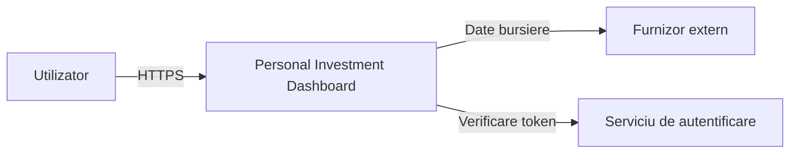
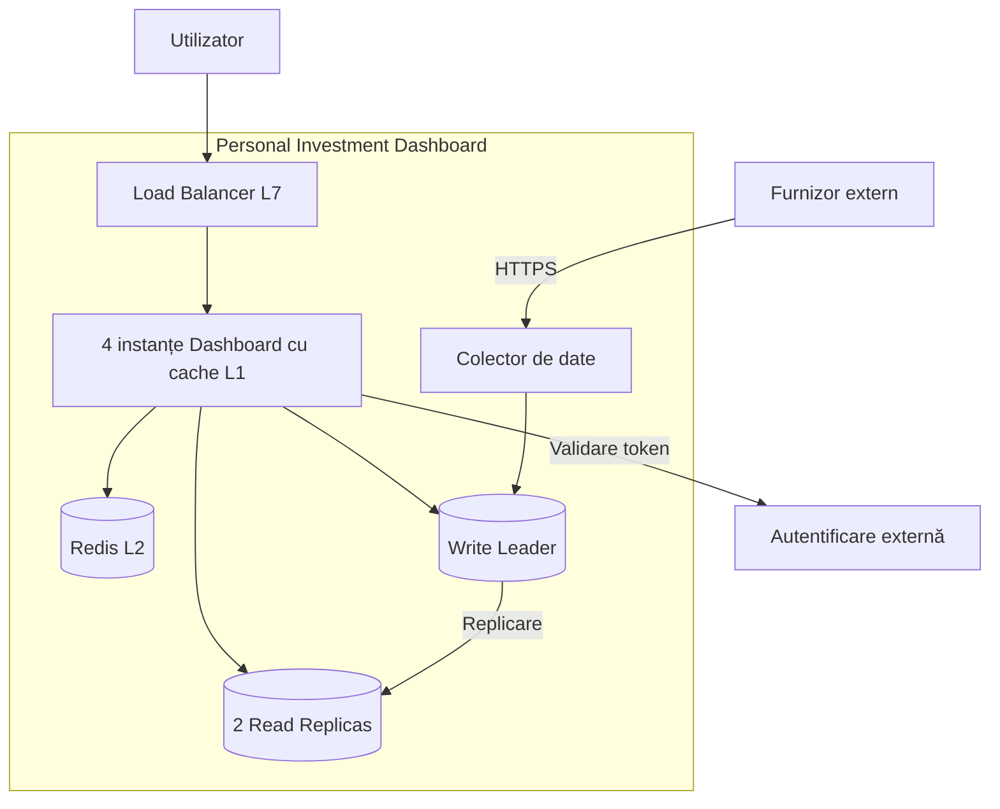
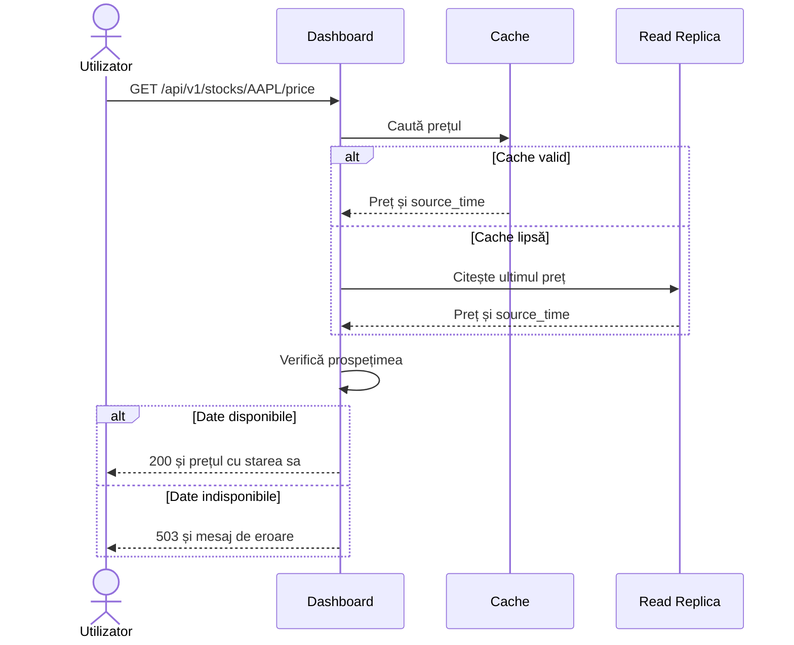

# Proiectarea întregului sistem – Personal Investment Dashboard

## 1. Problema și scopul

Aplicația oferă informații despre acțiuni bursiere și permite salvarea acestora într-un Watchlist privat.

| Element | Descriere |
|---|---|
| Utilizatori | Investitori individuali |
| Furnizor extern | Serviciu de date bursiere |
| Obiectiv | Acces rapid la informații despre acțiuni |
| Nu include | Tranzacții, ordine, portofolii și profit/pierdere |
| Constrângeri | Date actualizate, securitate, disponibilitate |

## 2. Cerințe funcționale

| Prioritate | Cerință |
|---|---|
| MUST | Afișarea acțiunilor și a prețurilor |
| MUST | Căutare după nume sau simbol |
| MUST | Filtrare și Trending |
| MUST | Istoricul zilnic al prețurilor |
| MUST | Watchlist privat cu adăugare și ștergere |
| SHOULD | Cache pentru citirile publice |
| SHOULD | Mesaje clare la erori |
| MUST NOT | Tranzacționare sau afișarea Watchlist-ului altui utilizator |

## 3. Calitate și încărcare

| Măsură | Țintă | Condiție |
|---|---|---|
| Timp de răspuns p95 | Sub 2 secunde | Încărcare proiectată |
| Stock Price | 600 cereri/secundă | 3.000 utilizatori |
| Capacitate cu rezervă | 720 cereri/secundă | Rezervă 20% |
| Instanțe Dashboard | 4 | Una poate fi oprită |
| Read Replicas | 2 | 400 cereri/secundă fiecare |
| Preț normal | Maximum 15 minute | Față de ora furnizorului |
| Preț întârziat | Peste 15, până la 60 minute | Afișat cu avertizare |
| Preț indisponibil | Peste 60 minute | Nu se afișează valoarea |

Presupunem că furnizorul oferă date valide și că încărcarea respectă estimările din laboratoarele anterioare. Valorile sunt ținte de proiectare, nu rezultate măsurate.

## 4. Arhitectura sistemului

### 4.1. System View

### 4.2. Container View

### 4.3. Responsabilități

| Componentă | Responsabilitate |
|---|---|
| Load Balancer | Distribuie cererile |
| Dashboard | Procesează cererile API |
| Cache L1 | Păstrează temporar date locale |
| Redis | Cache partajat între instanțe |
| Read Replicas | Citiri publice |
| Write Leader | Scrieri și Watchlist privat |
| Colector | Verifică și salvează datele bursiere |

**Date persistente:** Stock, LatestPrice, PriceHistory, WatchlistItem și SyncRecord sunt păstrate în baza de date. Redis și L1 sunt temporare. Proprietarul Watchlist-ului este identificat din autentificare.

## 5. Fluxul principal și erori

Scenariu: utilizatorul caută Apple și verifică prețul.

**Succes:** utilizatorul vede prețul și starea acestuia.

**Eșec:** dacă Redis nu funcționează, sistemul încearcă baza de date. Dacă nu există date disponibile, afișează un mesaj de eroare, fără preț inventat.

## 6. Soluții analizate

| Criteriu | O singură instanță | Instanțe multiple cu cache |
|---|---|---|
| Implementare | Simplă | Mai complexă |
| Scalare | Limitată | Mai bună |
| Disponibilitate | Depinde de o instanță | Permite oprirea unei instanțe |
| Cost | Mai mic | Mai mare |
| Încărcare mare | Risc de supraîncărcare | Cereri distribuite |

**Decizie:** alegem instanțe multiple, Redis și replici de citire, deoarece sistemul trebuie să suporte încărcarea estimată.

**Dezavantaj:** infrastructura este mai costisitoare și mai greu de administrat.

## 7. Riscuri și întrebări deschise

| Risc / întrebare | Responsabil | Acțiune | Când |
|---|---|---|---|
| Furnizorul nu răspunde | Dezvoltator backend | Tratarea erorilor și a datelor întârziate | Înainte de lansare |
| Redis indisponibil | Administrator infrastructură | Testarea citirii directe din baza de date | Înainte de lansare |
| Replici supraîncărcate | Administrator BD | Test de încărcare și dimensionare | Înainte de lansare |
| Token invalid | Dezvoltator backend | Verificarea autentificării | Înainte de lansare |
| Capacitate pentru alte citiri publice | Arhitect sistem | Măsurarea încărcării totale | Înainte de dimensionarea finală |

## Concluzie

Am descris arhitectura generală a aplicației, cerințele și componentele necesare. Soluția aleasă permite distribuirea cererilor, păstrarea datelor și tratarea erorilor.
