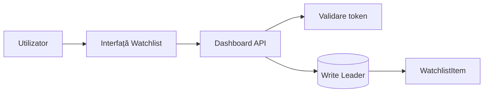
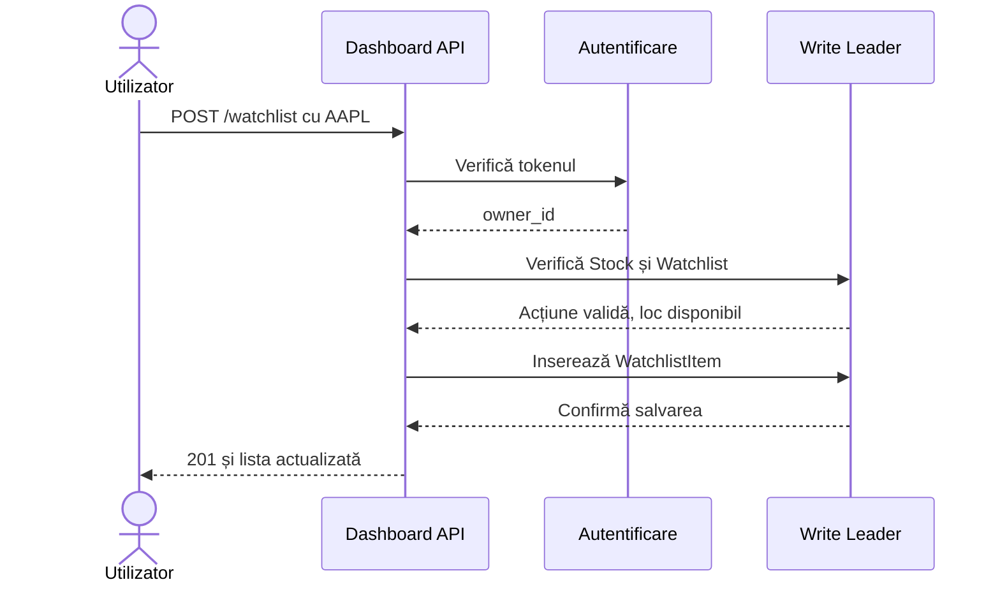

# Proiectarea funcționalității Watchlist

## 1. Scop și limite

Watchlist permite utilizatorului autentificat să salveze și să urmărească maximum 20 de acțiuni bursiere.

Funcționalitatea include:
- Vizualizarea listei personale;
- Adăugarea unei acțiuni;
- Eliminarea unei acțiuni;
- Verificarea proprietarului și tratarea erorilor.

Nu include cumpărarea sau vânzarea acțiunilor.

Este necesară o proiectare separată deoarece funcționalitatea implică autentificare, API, validare și stocarea datelor private.

## 2. Componente și interacțiuni



| Componentă | Rol |
|---|---|
| Interfață | Trimite cereri și afișează lista |
| Dashboard API | Validează cererile |
| Autentificare | Identifică utilizatorul |
| Write Leader | Salvează și citește datele private |
| WatchlistItem | Păstrează acțiunile utilizatorului |

Watchlist-ul privat nu folosește cache-ul public. Citirea se face din Write Leader pentru a vedea imediat modificările.

## 3. Modelul de date

Entitatea `WatchlistItem`:

| Câmp | Tip | Regulă |
|---|---|---|
| owner_id | VARCHAR(100) | Identificat din token |
| symbol | VARCHAR(10) | Referință către Stock |
| added_at | TIMESTAMPTZ | Stabilit de server |

**Cheie primară compusă:** `(owner_id, symbol)`.

Reguli:
- O acțiune nu poate apărea de două ori în lista aceluiași utilizator.
- Un utilizator poate avea maximum 20 de acțiuni.
- Un utilizator nu poate citi sau modifica lista altuia.
- Simbolul trebuie să existe în tabelul Stock.
- Adăugarea și ștergerea se execută într-o tranzacție.

## 4. API și reguli de acces

URL de bază: `/api/v1`

| Operație | Endpoint | Succes | Erori |
|---|---|---|---|
| Citire | GET /watchlist | 200 | 401, 503 |
| Adăugare | POST /watchlist | 201 | 400, 401, 404, 409, 503 |
| Ștergere | DELETE /watchlist/{symbol} | 204 | 400, 401, 404, 503 |

Toate cererile necesită token Bearer. Serverul determină `owner_id` din token, nu din corpul cererii.

**Exemplu de adăugare:**

```http
POST /api/v1/watchlist
Authorization: Bearer demo-token
Content-Type: application/json
```

```json
{
  "symbol": "AAPL"
}
```

Răspuns 201:

```json
{
  "symbols": ["AAPL"]
}
```

**Exemplu de eroare 409:**

```json
{
  "code": "already_exists",
  "message": "Acțiunea există deja în Watchlist"
}
```

Tokenul demonstrativ provine din laboratorul 5. În sistemul real, tokenul trebuie validat de serviciul de autentificare.

## 5. Fluxul normal



**Succes:** utilizatorul vede AAPL în Watchlist imediat după salvare.

## 6. Erori și recuperare

| Situație | Comportament |
|---|---|
| Token lipsă sau invalid | 401, solicită autentificarea |
| Acțiune inexistentă | 404, nu salvează |
| Acțiune deja salvată | 409, nu creează duplicat |
| Lista conține 20 de acțiuni | 400, refuză adăugarea |
| Baza de date indisponibilă | 503, afișează eroare |
| Răspuns pierdut după salvare | Clientul citește Watchlist înainte să repete adăugarea |

Pentru cereri repetate, cheia unică `(owner_id, symbol)` împiedică duplicatele. Verificarea limitei de 20 și inserarea se fac în aceeași tranzacție, cu blocare potrivită pentru a evita depășirea limitei la cereri simultane.

Dacă răspunsul se pierde, utilizatorul poate reîncărca lista pentru a verifica dacă acțiunea a fost salvată.

## 7. Două soluții analizate

| Criteriu | Watchlist în Redis | Watchlist în baza de date |
|---|---|---|
| Persistență | Necesită configurare suplimentară | Date persistente |
| Citire imediată | Posibilă | Posibilă prin Write Leader |
| Controlul duplicatelor | Necesită reguli suplimentare | Cheie unică |
| Potrivire cu arhitectura | Mai redusă | Respectă Lab 4 și Lab 5 |

**Decizie:** folosim baza de date prin Write Leader, deoarece Watchlist conține informații private care trebuie păstrate și citite imediat după modificare.

**Dezavantaj:** Write Leader poate deveni supraîncărcat dacă numărul de utilizatori crește.

## Concluzie

Am proiectat funcționalitatea Watchlist, stabilind componentele, datele, endpoint-urile și regulile de acces. Soluția aleasă protejează datele utilizatorilor și previne salvarea duplicatelor.
