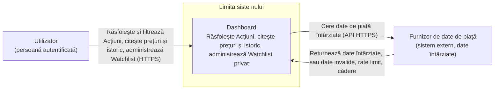
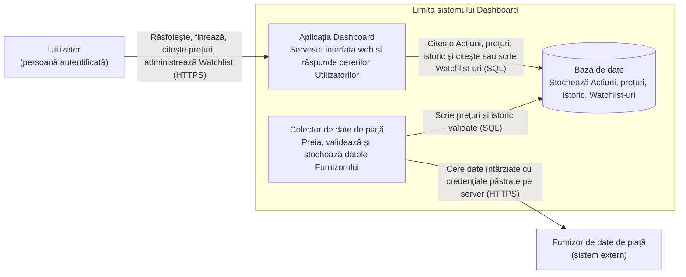
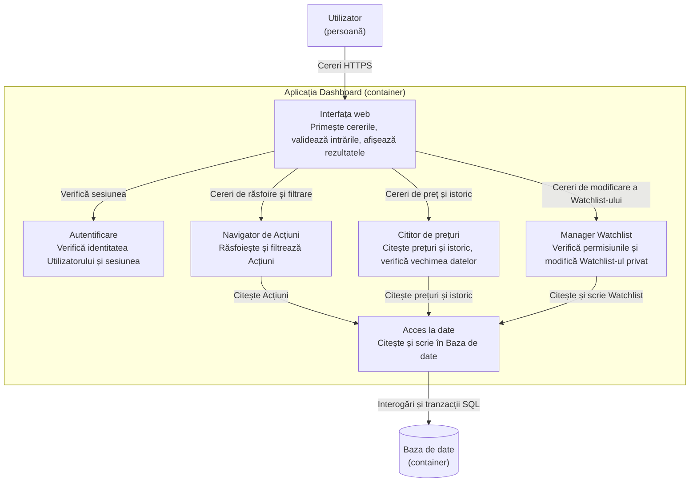
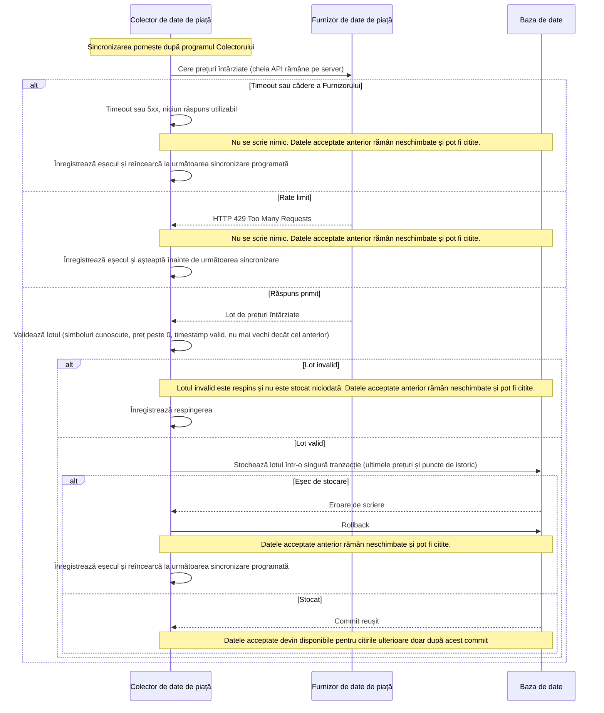
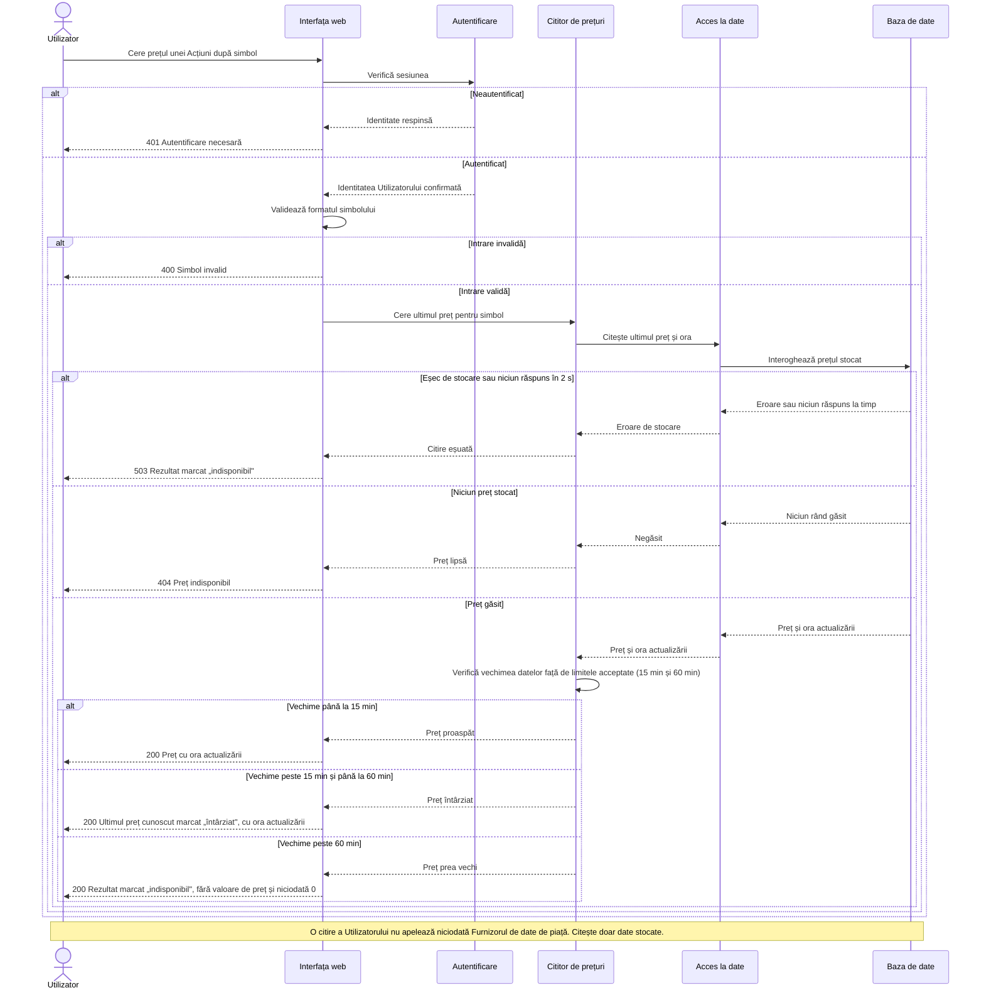
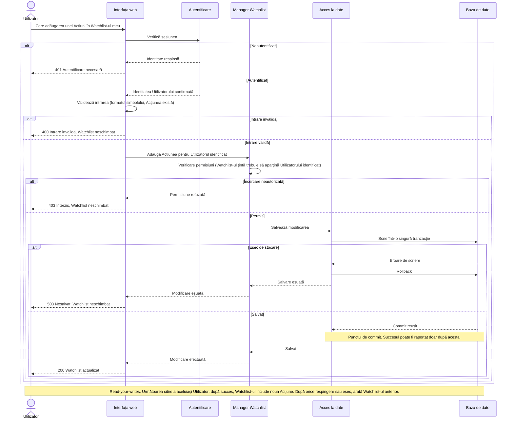

# Laboratorul 3: Desenează limitele Dashboard-ului

## Domeniu și ținte de încărcare

Dashboard-ul permite unui Utilizator autentificat să răsfoiască și să filtreze Acțiuni, să citească prețuri și istoric și să administreze un Watchlist privat. Un Furnizor de date de piață oferă date întârziate și poate returna date invalide, limitări de rată (rate limit) sau căderi (outage).

Ținte de încărcare din Lab 2 (folosite la dimensionarea designului):

| Țintă | Valoare din Lab 2 |
|---|---|
| Utilizatori (trei scări) | 300 / 3.000 / 30.000 |
| Încărcare constantă de citiri | 79,2 / 792 / 7.920 RPS |
| Vârf la deschiderea pieței (cu marjă de 10%) | 103 / 1.030 / 10.296 RPS |
| Cea mai frecventă citire (Stock price) | 60 / 600 / 6.000 RPS |
| Latență | p95 al citirilor sub 2 s. O citire peste 2 s este întreruptă și returnează un rezultat marcat clar „indisponibil". |
| Disponibilitate | 99,9% în orele de piață (09:30-16:00, L-V), 99,5% în restul zilei |
| Prospețimea prețului | Până la 15 min: normal. Peste 15 min: marcat „întârziat". Peste 60 min fără actualizare: „indisponibil" (niciodată 0). |
| Consistența Watchlist-ului | Read-your-writes: următoarea citire a aceluiași Utilizator arată imediat modificarea |
| Stocare | Aproximativ 5.700 de Acțiuni, circa 71,1 MB/zi de istoric, circa 17,93 GB pe an (retenție 252 de zile) |

Consecințe ale acestor ținte asupra designului:
- Citirile Utilizatorilor sunt servite doar din Baza noastră de date, deci latența de citire nu depinde de Furnizor. Setul ultimelor prețuri este mic (circa 0,14 MB), deci cea mai frecventă citire (Stock price) poate fi servită rapid din Baza de date.
- Furnizorul este apelat doar de Colectorul de date de piață, după un program, deci numărul de Utilizatori nu schimbă numărul de cereri către Furnizor.
- Colectorul este un container separat, deci o problemă la Furnizor nu poate încetini sau întrerupe celelalte citiri.
- Citirile și scrierile Watchlist-ului folosesc aceeași Bază de date, iar succesul se raportează doar după commit, deci read-your-writes este respectat.

---

## 1. Diagrama de context al sistemului (System Context)

**Ipoteze**
- Autentificarea face parte din Dashboard. Utilizatorul ajunge deja autentificat, deci nu este desenat un sistem de identitate separat.
- Există un singur sistem extern: Furnizorul de date de piață.
- Pe acest nivel nu sunt arătate părți interne de execuție.

---

## 2. Diagrama de containere (Container)

**Responsabilități (câte una pentru fiecare parte)**
- **Aplicația Dashboard**: gestionează toate cererile Utilizatorilor (identitate, verificarea intrărilor, citiri, modificări de Watchlist).
- **Colector de date de piață**: rulează sincronizarea cu Furnizorul, validează datele și stochează doar datele acceptate.
- **Baza de date**: singurul loc de stocare pentru Acțiuni, prețuri, istoric și Watchlist-uri.

**Ipoteze**
- Acesta este cel mai mic set care îndeplinește cerințele: separarea Colectorului de Aplicație ține problemele Furnizorului departe de citirile Utilizatorilor, iar Baza de date este stocarea comună a celor două.
- Aplicația Dashboard nu apelează niciodată Furnizorul. Credențialele Furnizorului există doar în configurația Colectorului, pe server.
- Colectorul pornește sincronizările după propriul program.
- Nu se adaugă un container separat de cache. Datele ultimelor prețuri sunt mici și Baza de date le servește. Dacă testele de încărcare arată p95 peste 2 s, un cache este prima schimbare de luat în calcul.

---

## 3. Diagrama de componente (Aplicația Dashboard)

**Ipoteze**
- Este deschisă doar Aplicația Dashboard. Utilizatorul și Baza de date sunt singurele elemente exterioare care comunică direct cu componentele ei.
- Colectorul de date de piață și Furnizorul nu apar, pentru că nu comunică direct cu Aplicația Dashboard. Colectorul ajunge la Aplicație doar prin datele stocate în Baza de date.
- Sesiunea este un token semnat, deci Autentificarea o poate verifica fără apel către stocare.

---

## 4. Diagrame de secvență

### A. Sincronizarea datelor de piață

**Ipoteze**
- Sincronizarea este pornită de programul Colectorului, nu de o acțiune a Utilizatorului.
- Un lot este acceptat sau respins în întregime. O sincronizare eșuată sau respinsă nu schimbă niciodată datele acceptate anterior, iar Utilizatorii continuă să citească ultimele date acceptate.
- Cât timp sincronizările continuă să eșueze, prețurile păstrate îmbătrânesc: după 15 min citirile le arată ca „întârziate", după 60 min fără actualizare citirile arată „indisponibil" (niciodată 0).
- Credențialele Furnizorului rămân pe server (configurația Colectorului). Nu sunt trimise niciodată către browser.

### B. Citirea prețului unei Acțiuni

**Ipoteze**
- Limitele de vechime acceptate vin din Lab 2: până la 15 min este normal, peste 15 min este marcat „întârziat", peste 60 min fără actualizare este „indisponibil" (niciodată 0).
- Dacă citirea nu se termină în 2 s (limita de latență din Lab 2), cererea este întreruptă, iar Utilizatorul primește un rezultat marcat clar „indisponibil", nu o cerere blocată.
- Un preț „întârziat" este afișat totuși, marcat clar și cu ora actualizării, ca Utilizatorul să nu fie indus în eroare.
- O citire a Utilizatorului nu necesită niciodată o cerere nouă către Furnizor. Doar Colectorul de date de piață comunică cu Furnizorul.

### C. Modificarea unui Watchlist privat

**Ipoteze**
- Proprietarul Watchlist-ului este luat din sesiunea verificată, niciodată din corpul cererii. Un Utilizator nu poate modifica Watchlist-ul altui Utilizator.
- Succesul este raportat doar după commit-ul în Baza de date. După o modificare respinsă sau eșuată, următoarea citire a aceluiași Utilizator arată exact Watchlist-ul de dinaintea cererii.
- Datele Watchlist-ului sunt private: sunt returnate doar proprietarului lor.

---

## Checklist

- [x] Am inclus o diagramă System Context, una Container și una Component.
- [x] Am inclus cele trei diagrame de secvență cerute.
- [x] Toate cele șase blocuri Mermaid se randează fără eroare.
- [x] Diagrama Component deschide doar Aplicația Dashboard.
- [x] Fluxurile mele arată rezultate normale, acțiuni respinse și rezultate de eșec.
- [x] Designul acoperă citiri normale, date private, preluarea datelor de la Furnizor și eșecurile.
