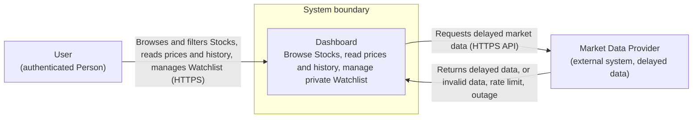
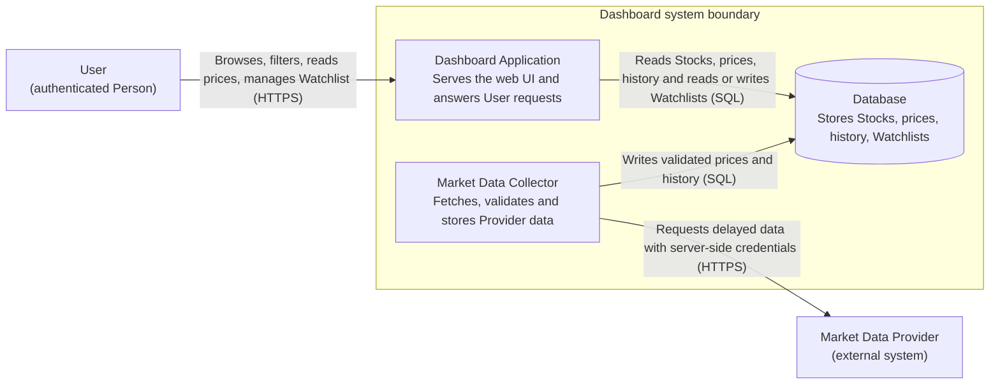
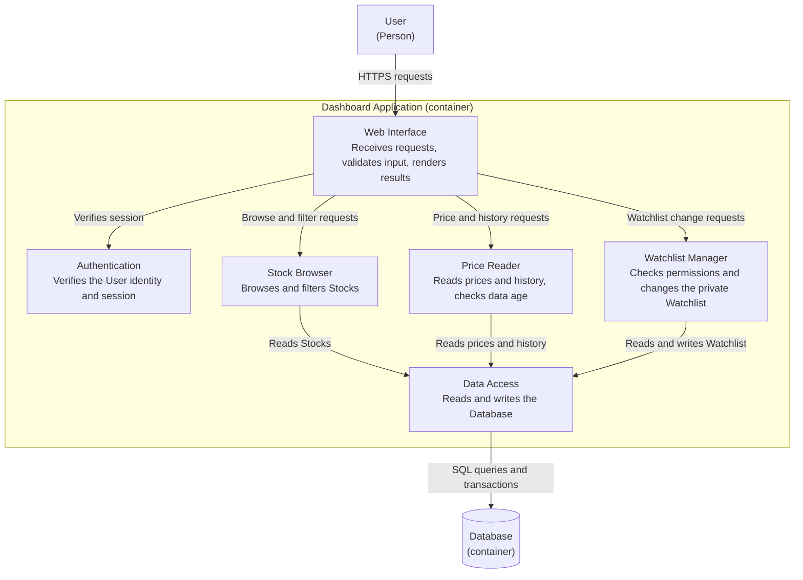
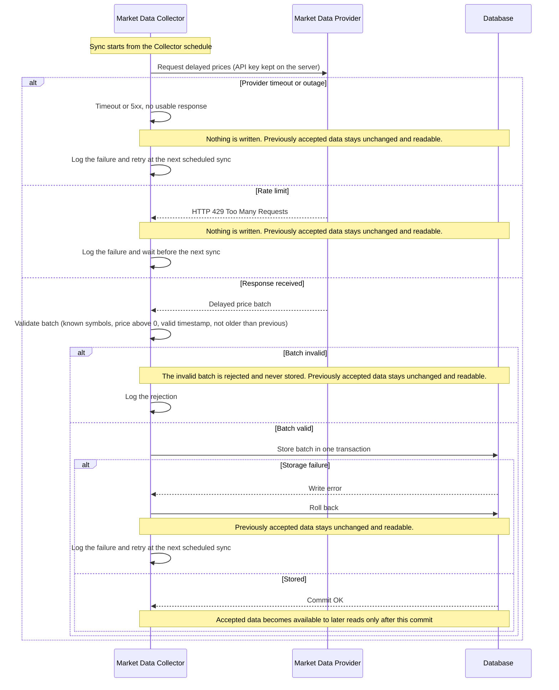
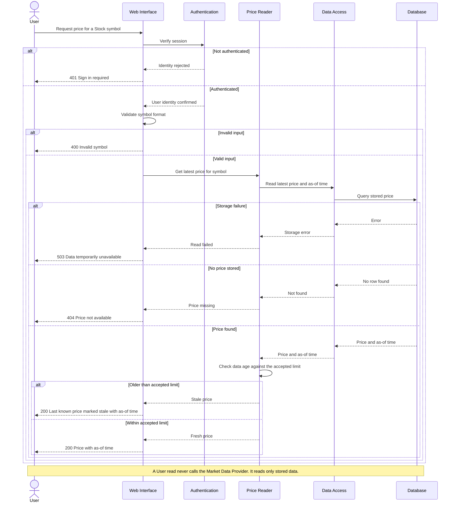
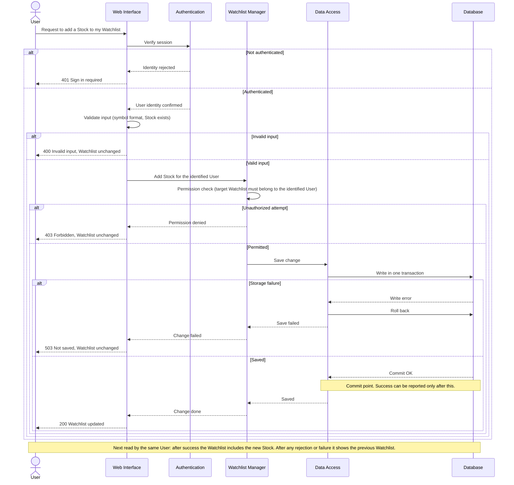

# Lab 3: Draw the Dashboard Boundary

## Scope and load targets

The Dashboard lets an authenticated User browse and filter Stocks, read prices and history, and manage a private Watchlist. A Market Data Provider supplies delayed data and can return invalid data, rate limits, or outages.

Load targets from Lab 2 (used to size the design):

| Target | Value from Lab 2 |
|---|---|
| Concurrent Users | **[FILL IN from Lab 2]** |
| Read latency target | **[FILL IN from Lab 2]** |
| Sync frequency / data freshness limit | **[FILL IN from Lab 2]** |

Design consequences of these targets: User reads are served only from our own Database, so read latency does not depend on the Provider. The Provider is called only by the Market Data Collector on a schedule, so the number of Users does not change the number of Provider requests.

---

## 1. System-context diagram

**Assumptions**
- Authentication is part of the Dashboard. The User arrives already authenticated, so no separate identity system is drawn.
- Only one external system exists: the Market Data Provider.
- No internal runtime parts are shown on this level.

---

## 2. Container diagram

**Responsibilities (one per part)**
- **Dashboard Application**: handles all User requests (identity, input checks, reads, Watchlist changes).
- **Market Data Collector**: runs the sync with the Provider, validates the data, and stores only accepted data.
- **Database**: the single store for Stocks, prices, history, and Watchlists.

**Assumptions**
- This is the smallest set that meets the requirements: separating the Collector from the Application keeps Provider failures away from User reads, and the Database is shared storage between the two.
- The Dashboard Application never calls the Provider. Provider credentials exist only in the Collector configuration on the server.
- The Collector starts syncs from its own schedule.

---

## 3. Component diagram (Dashboard Application)

**Assumptions**
- Only the Dashboard Application is opened. User and Database are the only outside elements that communicate directly with its components.
- The Market Data Collector and the Provider are not shown because they do not communicate directly with the Dashboard Application. The Collector reaches the Application only through data stored in the Database.
- The session is a signed token, so Authentication can verify it without a storage call.

---

## 4. Sequence diagrams

### A. Sync market data

**Assumptions**
- Sync is started by the Collector schedule, not by a User action.
- A batch is accepted or rejected as a whole. A failed or rejected sync never changes previously accepted data, and Users keep reading the last accepted data.
- Provider credentials stay on the server (Collector configuration). They are never sent to the browser.

### B. Read a Stock price

**Assumptions**
- The accepted age limit is the freshness limit from Lab 2. **[FILL IN the value]**
- A stale price is still shown, clearly marked as stale with its as-of time, so the User is not misled.
- A User read never needs a new Provider request. Only the Market Data Collector talks to the Provider.

### C. Change a private Watchlist

**Assumptions**
- The Watchlist owner is taken from the verified session, never from the request body. A User cannot change another User's Watchlist.
- Success is reported only after the Database commit. After a rejected or failed change, the same User's next read shows exactly the Watchlist from before the request.
- Watchlist data is private: it is returned only to its owner.

---

## Checklist

- [x] I included one System Context, one Container, and one Component diagram.
- [x] I included the three required sequence diagrams.
- [x] All six Mermaid blocks render without an error.
- [x] The Component diagram opens only the Dashboard Application.
- [x] My flows show normal results, rejected actions, and failure results.
- [x] The design covers normal reads, private data, provider ingestion, and failures.
