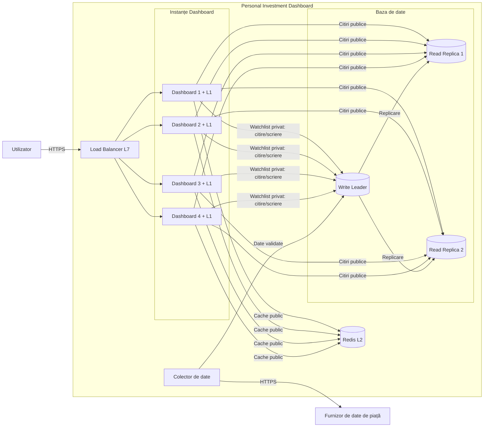
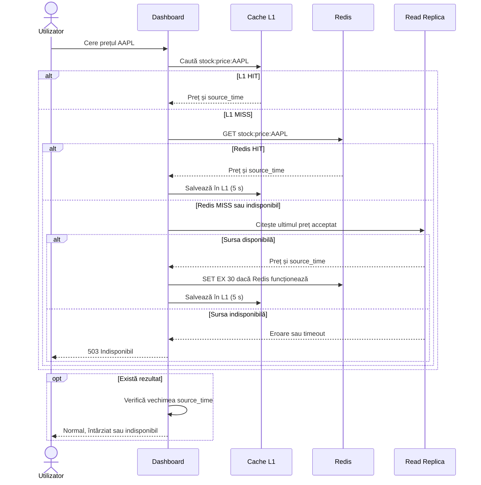
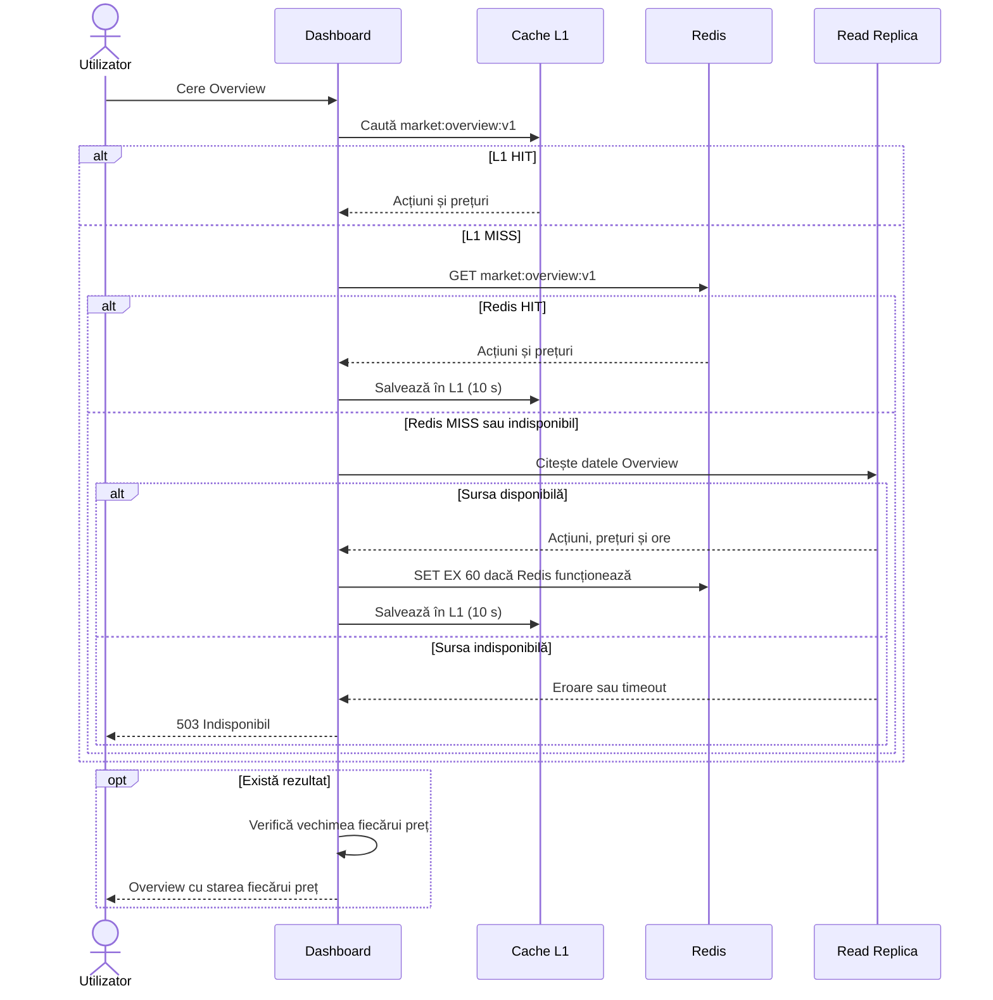
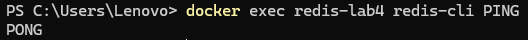
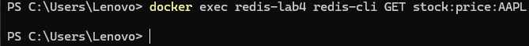
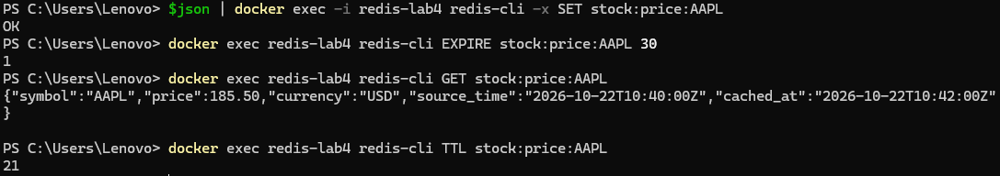
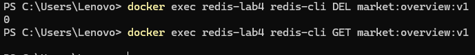
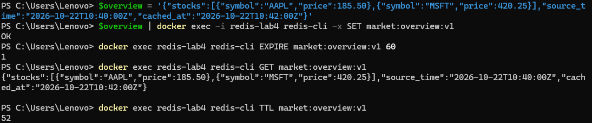

# Laboratorul 4: Scalarea citirilor din Dashboard

## Scop
Scalarea aplicației Personal Investment Dashboard prin distribuirea cererilor, replicarea bazei de date și utilizarea cache-ului L1 și Redis, respectând cerințele din Lab 2 și arhitectura din Lab 3.

## 1. Scalarea serviciului și distribuirea cererilor

### 1.1. Calculul instanțelor Dashboard

- Cereri Stock Price: 600 RPS
- Rezervă 20%: 600 × 1,20 = **720 RPS**
- Capacitate per instanță: 250 RPS
- Instanțe necesare: ⌈720 / 250⌉ = 3
- Rezervă pentru oprirea unei instanțe: 3 + 1 = **4 instanțe**

**Verificare:** (4 − 1) × 250 = 750 RPS ≥ 720 RPS.

**Decizie:** 4 instanțe Dashboard.

### 1.2. Load Balancer

- **Nivel:** L7 (Application Layer)
- **Metodă:** Least Connections
- **Motiv:** distribuie cererile către instanțele cu cele mai puține conexiuni active și permite verificarea disponibilității.
- **Limitare:** numărul conexiunilor nu reflectă întotdeauna consumul real de resurse.

### 1.3. Păstrarea datelor

| Date persistente | Date temporare |
|---|---|
| Acțiuni, prețuri, istoric – Baza de date | Cache L1 – memoria instanței |
| Watchlist privat – Baza de date | Cereri în procesare |
| Sesiune – token semnat, verificabil de orice instanță | Cache Redis – reconstruibil din Baza de date |

Oprirea unei instanțe nu afectează datele persistente. Cache-ul L1 se pierde, iar cererile întrerupte pot fi reluate.

## 2. Scalarea Market Data Store

### 2.1. Calculul replicilor

- Țintă: 720 RPS
- Capacitate per replică: 400 RPS
- Replici necesare: ⌈720 / 400⌉ = **2**
- Capacitate totală: 2 × 400 = 800 RPS ≥ 720 RPS

**Decizie:** 1 Write Leader pentru scrieri și 2 Read Replicas pentru citiri Stock Price, în total **3 noduri**.

Calculul nu presupune cache hits. Dacă o replică se oprește, capacitatea de citire scade sub țintă.


**Limitare:** cele 2 replici acoperă doar cei 720 RPS pentru Stock Price. Celelalte citiri publice pot necesita capacitate suplimentară sau optimizare. Write Leader rămâne rezervat pentru scrieri și citirile care cer cele mai noi date.

### 2.2. Diagrama Container View actualizată



### 2.3. Decizii de arhitectură

- Load Balancer-ul distribuie cererile către 4 instanțe Dashboard.
- Fiecare instanță utilizează cache local L1 și Redis partajat.
- Citirile publice folosesc replicile bazei de date.
- Watchlist-ul privat folosește Write Leader pentru read-your-writes.
- Colectorul validează datele Furnizorului înainte de salvare.
- Datele persistente rămân în Baza de date.

**Modificări față de Lab 3:** adăugarea Load Balancer-ului, a 4 instanțe Dashboard, a cache-ului L1/Redis și a 2 replici de citire.

**Cerințe păstrate din Lab 2:** p95 sub 2 s; preț normal ≤15 min, întârziat >15 min, indisponibil >60 min; Watchlist privat cu read-your-writes.

## 3. Cache pentru două tipuri de citiri publice

### 3.1. Alegerea citirilor

Folosim cache L1 (memorie locală) și L2 (Redis) pentru două citiri publice:

| Citire | Motiv |
|---|---|
| Stock Price | Cea mai frecventă citire: 600 RPS la 3.000 de Utilizatori |
| Overview | Afișează lista Acțiunilor și prețurile, fiind accesată frecvent |

Datele Watchlist-ului sunt private și nu sunt păstrate în cache-ul public.

### 3.2. Contractul cache-ului

| Proprietate | Stock Price | Overview |
|---|---|---|
| Cheie Redis | `stock:price:AAPL` | `market:overview:v1` |
| Conținut | Preț, simbol, timestamp | Listă Acțiuni, prețuri, timestamp-uri |
| TTL L1 | 5 secunde | 10 secunde |
| TTL Redis | 30 secunde | 60 secunde |
| Cache miss | Citire din Read Replica | Citire din Read Replica |
| Invalidare | TTL sau actualizare după commit | TTL sau actualizare după commit |


Pentru Stock Price, cheia include simbolul acțiunii. Pentru Overview, cheia `market:overview:v1` reprezintă lista standard. Dacă apar filtre, sortare sau paginare, acestea trebuie incluse în cheia cache-ului, pentru a nu returna rezultate greșite.

**Reguli comune:**

- L1 este local fiecărei instanțe Dashboard.
- Redis este partajat între toate instanțele.
- Datele sunt salvate în cache doar după citirea reușită din Baza de date.
- Timestamp-ul original al prețului se păstrează în cache.
- La fiecare răspuns se verifică vechimea datelor.
- Preț ≤15 min: normal; >15 min: întârziat; >60 min: indisponibil.
- Nu se returnează niciodată prețul 0 pentru date lipsă.
- Cache-ul public nu conține informații private.

### 3.3. Diagrama de secvență – Stock Price



**Explicație:** Dashboard verifică L1, apoi Redis și, la cache miss, Read Replica. Rezultatul este salvat temporar și verificat înainte de afișare.

### 3.4. Diagrama de secvență – Overview



**Explicație:** Overview folosește aceleași două niveluri de cache, dar cu TTL diferit. Fiecare preț este verificat individual.

### 3.5. Tratarea erorilor

| Situație | Comportament |
|---|---|
| Redis indisponibil | Dashboard citește direct din Read Replica |
| Read Replica indisponibilă | Încearcă cealaltă replică |
| Date lipsă | Returnează „indisponibil", nu 0 |
| Preț mai vechi de 60 min | Nu afișează valoarea prețului |
| Timeout peste 2 s | Întrerupe cererea și returnează „indisponibil" |

**Decizie:** cache-ul îmbunătățește performanța, dar Baza de date rămâne sursa principală a datelor. TTL-ul cache-ului nu înlocuiește verificarea prospețimii prețurilor.


### 3.6. Sursa datelor și prospețimea

| Citire | Sursa durabilă | Politica de cache |
|---|---|---|
| Stock Price | Ultimul preț acceptat și ora Furnizorului, din Market Data Store | TTL simplu: L1 5 s, Redis 30 s |
| Overview | Acțiuni, ultimele prețuri și orele Furnizorului, din Market Data Store | TTL simplu: L1 10 s, Redis 60 s |

Valorile JSON păstrează separat `cached_at` (ora introducerii în cache) și `source_time` (ora datelor Furnizorului).

TTL-ul Redis controlează durata cache-ului, nu prospețimea datelor. La fiecare citire se aplică limitele din Lab 2: normal ≤15 min, întârziat >15 min, indisponibil >60 min.

### 3.7. Warmup și recuperare

Înainte de deschiderea pieței (09:30) și după recuperarea Redis, preîncărcăm maximum 100 de simboluri publice frecvent accesate și un rezultat Overview, folosind datele acceptate din Market Data Store.

| Situație | Rezultat pentru Utilizator |
|---|---|
| Warmup incomplet | Citire normală din cache sau Baza de date; latență posibil mai mare |
| Capacitate fallback disponibilă | Citire directă din Read Replica |
| Capacitate fallback epuizată | 503 „indisponibil"; nu afișăm valori inventate |
| Sursă durabilă indisponibilă | Dacă nu există date valide în cache: 503 „indisponibil" |

Warmup-ul este limitat pentru a evita supraîncărcarea bazei de date. Nu presupunem cache hits în calculele de capacitate.


## 4. Testarea practică Redis

### 4.1. Pornirea și verificarea Redis

Am pornit Redis într-un container Docker, fără persistență pe disc.

Comanda de verificare:

```powershell
docker exec redis-lab4 redis-cli PING
```

Rezultat: `PONG`. Redis funcționează corect.

### 4.2. Testul Stock Price

Cheia utilizată: `stock:price:AAPL`.

| Operație | Rezultat |
|---|---|
| GET inițial | Cache MISS (valoare lipsă) |
| Citire din sursa durabilă | Simulată cu date de exemplu |
| SET JSON | OK |
| EXPIRE 30 | 1 |
| GET repetat | Cache HIT, JSON returnat |
| TTL | 21 secunde rămase |

Exemplu de valoare JSON:

```json
{
  "symbol": "AAPL",
  "price": 185.50,
  "currency": "USD",
  "source_time": "2026-10-22T10:40:00Z",
  "cached_at": "2026-10-22T10:42:00Z"
}
```

### 4.3. Testul Overview

Cheia utilizată: `market:overview:v1`.

| Operație | Rezultat |
|---|---|
| GET inițial | Cache MISS (valoare lipsă) |
| Citire din sursa durabilă | Simulată cu date de exemplu |
| SET JSON | OK |
| EXPIRE 60 | 1 |
| GET repetat | Cache HIT, JSON returnat |
| TTL | 52 secunde rămase |

Exemplu de valoare JSON:

```json
{
  "stocks": [
    {"symbol": "AAPL", "price": 185.50},
    {"symbol": "MSFT", "price": 420.25}
  ],
  "source_time": "2026-10-22T10:40:00Z",
  "cached_at": "2026-10-22T10:42:00Z"
}
```

### 4.4. Prospețimea și persistența datelor

`source_time` reprezintă ora datelor de la Furnizor, iar `cached_at` reprezintă ora introducerii în cache.

TTL-ul arată cât timp mai există cheia în Redis, dar nu garantează că prețul este actual. Prospețimea se verifică folosind `source_time`.

Am ales Redis fără persistență pe disc (fără RDB și AOF), deoarece este folosit doar ca nivel de cache. După repornire, Redis poate fi gol, iar datele trebuie reconstruite din Market Data Store.

Dacă Redis nu funcționează, Dashboard citește direct din Read Replica, în limita capacității disponibile. Dacă nu poate obține date valide, returnează „indisponibil”.

În testarea practică am folosit `SET` și `EXPIRE` separat, pentru a salva JSON-ul corect din PowerShell. În aplicație, salvarea și expirarea trebuie făcute împreună, prin `SET` cu `EX`, ca să evităm o cheie fără TTL.

**Notă:** Testele Redis au fost executate practic. Citirea din Market Data Store a fost simulată cu date JSON de exemplu; nu a fost testată o conexiune reală la baza de date.


### 4.5. Dovezi ale testării practice Redis

Mai jos sunt capturile de ecran realizate în PowerShell, care confirmă executarea comenzilor Redis.

**1. Verificarea conexiunii Redis – PING/PONG**



**2. Stock Price – Cache MISS**



**3. Stock Price – SET, GET HIT și TTL**



**4. Overview – Cache MISS**



**5. Overview – SET, GET HIT și TTL**




## 5. Concluzie

În acest laborator am proiectat scalarea Dashboard-ului folosind Load Balancer, 4 instanțe Dashboard, două replici de citire și cache L1/Redis. Am testat practic comenzile Redis pentru Stock Price și Overview, inclusiv Cache MISS, Cache HIT și TTL.
Soluția reduce încărcarea bazei de date, iar în cazul pierderii cache-ului, datele pot fi reconstruite din sursa durabilă.

## 6. Checklist final

- [x] Calculul instanțelor Dashboard și rezerva de 20%.
- [x] Alegerea Load Balancer-ului și explicarea limitării.
- [x] Calculul replicilor și precizarea capacității.
- [x] Actualizarea diagramei Container View.
- [x] Păstrarea cerințelor din Lab 2 și Lab 3.
- [x] Cache L1 și Redis pentru Stock Price și Overview.
- [x] Două diagrame de secvență cu HIT, MISS și erori.
- [x] TTL, prospețimea datelor și tratarea erorilor.
- [x] Warmup limitat și recuperarea după pierderea cache-ului.
- [x] Testarea Redis: PING, GET, SET, EXPIRE și TTL.
- [x] Screenshoturi cu rezultatele testelor.
- [x] Explicarea persistenței Redis și a limitărilor testării.
