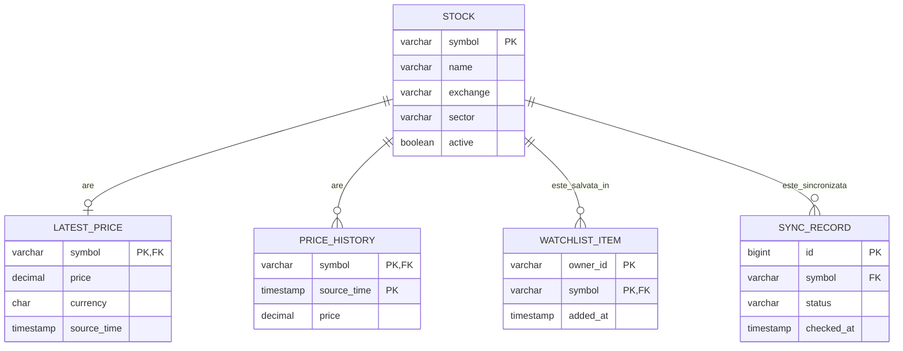
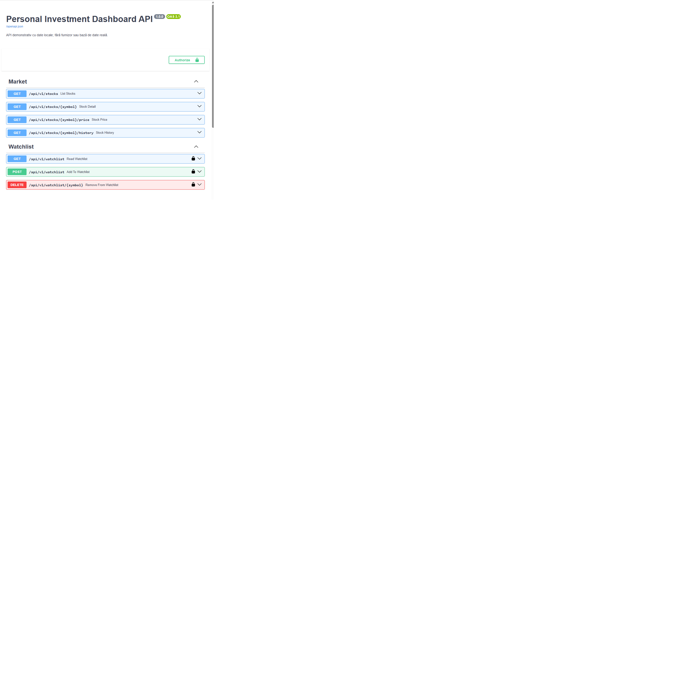

# Laboratorul 5: Modelarea Dashboard-ului și definirea API-ului

## Scopul lucrării

Definirea modelului de date și a API-ului HTTP pentru aplicația Personal Investment Dashboard, apoi generarea documentației OpenAPI.

Proiectul continuă laboratoarele 1–4 și include date despre acțiuni și o listă personală de urmărire (Watchlist).

## 1. Modelul de date

### 1.1. Entitățile aplicației

| Entitate | Scop | Câmpuri și exemple | Relații |
|---|---|---|---|
| Stock | Informații despre acțiuni | symbol VARCHAR(10) = AAPL (PK), name VARCHAR(100) = Apple Inc., exchange VARCHAR(10) = NASDAQ, sector VARCHAR(50) = Technology, active BOOLEAN = true | 1:N cu PriceHistory, WatchlistItem și SyncRecord; 1:1 cu LatestPrice |
| LatestPrice | Ultimul preț acceptat | symbol VARCHAR(10) = AAPL (PK, FK), price DECIMAL(12,2) = 185.50, currency CHAR(3) = USD, source_time TIMESTAMPTZ = 2026-10-22T10:40:00Z | Aparține unei acțiuni |
| PriceHistory | Istoricul prețurilor | symbol VARCHAR(10) = AAPL (PK, FK), source_time TIMESTAMPTZ = 2026-10-22T10:39:00Z (PK), price DECIMAL(12,2) = 185.40 | Aparține unei acțiuni |
| WatchlistItem | Acțiunile salvate de utilizator | owner_id VARCHAR(100) = user-1 (PK), symbol VARCHAR(10) = AAPL (PK, FK), added_at TIMESTAMPTZ = 2026-10-22T10:45:00Z | Leagă utilizatorul de acțiune |
| SyncRecord | Evidența sincronizării | id BIGINT = 1 (PK), symbol VARCHAR(10) = AAPL (FK), status VARCHAR(10) = accepted, checked_at TIMESTAMPTZ = 2026-10-22T10:41:00Z | Aparține unei acțiuni |

**Reguli de validare:**
- Simbolul acțiunii este unic și conține maximum 10 litere mari.
- Prețul trebuie să fie pozitiv.
- Câmpul `active` poate fi `true` sau `false`.
- `status` poate fi `accepted` sau `rejected`.
- `source_time` nu poate fi în viitor.
- Un preț nou acceptat nu poate fi mai vechi decât ultimul preț acceptat.
- În Watchlist, aceeași acțiune poate apărea o singură dată pentru un utilizator.
- Un utilizator poate salva maximum 20 de acțiuni.
- `owner_id`, `added_at` și datele sincronizării sunt stabilite de server.

### 1.2. Diagrama ER



Utilizatorul este identificat prin tokenul de autentificare. Nu este necesar un tabel local `User`. Fiecare element Watchlist aparține unui singur utilizator.

### 1.3. Date calculate și actualizare

- `changePercent` reprezintă variația zilnică procentuală și este calculată, nu stocată.
- Lista Trending este ordonată descrescător după valoarea absolută a variației zilnice. La egalitate, se ordonează după simbol.
- `freshness` indică actualitatea datelor:
  - `normal` – maximum 15 minute;
  - `delayed` – peste 15 minute, până la 60 de minute;
  - `unavailable` – peste 60 de minute.
- Istoricul conține puncte la intervale de un minut în orele pieței și se păstrează 252 de zile de tranzacționare.
- `source_time` reprezintă ora datelor de la furnizor, iar `cached_at` reprezintă ora salvării în cache.

## 2. Endpoint-urile API

URL de bază: `http://127.0.0.1:8000/api/v1`

### 2.1. Lista endpoint-urilor

| Acțiune | Metodă și cale | Parametri / corp | Succes | Acces |
|---|---|---|---|---|
| Listă, Trending, căutare și filtrare | GET /stocks | page, pageSize, search, exchange, sort | 200 | Public |
| Detalii acțiune | GET /stocks/{symbol} | symbol | 200 | Public |
| Ultimul preț | GET /stocks/{symbol}/price | symbol | 200 | Public |
| Istoricul prețurilor | GET /stocks/{symbol}/history | symbol, limit | 200 | Public |
| Citire Watchlist | GET /watchlist | Token Bearer | 200 | Privat |
| Adăugare în Watchlist | POST /watchlist | {"symbol":"AAPL"} | 201 | Privat |
| Ștergere din Watchlist | DELETE /watchlist/{symbol} | symbol, token | 204 | Privat |

### 2.2. Parametri și validare

| Parametru | Reguli |
|---|---|
| page | Implicit 1, minimum 1 |
| pageSize | Implicit 10, între 1 și 50 |
| search | Opțional, maximum 50 de caractere |
| exchange | NASDAQ sau NYSE |
| sort | symbol sau trending; implicit symbol |
| symbol | Obligatoriu, 1–10 litere mari |
| limit | Implicit 3, între 1 și 100 |

### 2.3. Exemple JSON

**Listă filtrată:**

Cerere: `GET /stocks?exchange=NASDAQ&search=Apple&page=1&pageSize=10`

```json
{
  "items": [
    {
      "symbol": "AAPL",
      "name": "Apple Inc.",
      "exchange": "NASDAQ",
      "sector": "Technology",
      "active": true,
      "changePercent": 1.2
    }
  ],
  "page": 1,
  "pageSize": 10,
  "total": 1,
  "nextPage": null
}
```

**Listă fără rezultate:**

Cerere: `GET /stocks?search=Inexistent`

```json
{
  "items": [],
  "page": 1,
  "pageSize": 10,
  "total": 0,
  "nextPage": null
}
```

**Ultimul preț:**

Cerere: `GET /stocks/AAPL/price`

```json
{
  "symbol": "AAPL",
  "price": 185.5,
  "currency": "USD",
  "sourceTime": "2026-11-19T11:00:00Z",
  "freshness": "normal"
}
```

**Istoricul prețurilor:**

Cerere: `GET /stocks/AAPL/history?limit=2`

```json
{
  "symbol": "AAPL",
  "items": [
    {
      "sourceTime": "2026-11-19T11:00:00Z",
      "price": 185.5
    },
    {
      "sourceTime": "2026-11-19T10:59:00Z",
      "price": 185.4
    }
  ]
}
```

**Adăugare în Watchlist:**

Cerere: `POST /watchlist`

Autentificare: `Authorization: Bearer demo-token`

Corp:

```json
{
  "symbol": "AAPL"
}
```

Răspuns 201:

```json
{
  "symbols": ["AAPL"]
}
```

**Exemplu de eroare:**

Cerere: `GET /stocks/UNKNOWN`

Răspuns 404:

```json
{
  "code": "not_found",
  "message": "Acțiunea nu există"
}
```

Exemplele folosesc date demonstrative, nu prețuri bursiere reale.

### 2.4. Reguli API

**Versiune:** API-ul folosește `/api/v1`. Adăugarea unui câmp opțional în răspuns este o schimbare compatibilă. Redenumirea câmpului `symbol` este incompatibilă și necesită o versiune nouă.

**Autentificare:** Endpoint-urile publice nu necesită autentificare. Watchlist necesită token Bearer. Proprietarul listei este identificat din token, nu din cerere. În demonstrație folosim `demo-token`; într-o aplicație reală tokenul trebuie validat.

**Paginare:** Listele folosesc `page` și `pageSize`. Răspunsul conține `total` și `nextPage`. Dacă `nextPage` este `null`, nu mai există pagini.

**Erori:**

| Cod | Semnificație |
|---|---|
| 400 | Date introduse greșit |
| 401 | Autentificare lipsă sau invalidă |
| 404 | Resursa nu există |
| 409 | Acțiunea există deja în Watchlist |
| 429 | Prea multe cereri |
| 503 | Serviciu indisponibil |

Erorile folosesc aceeași structură JSON: `code` și `message`. La eroarea 429, clientul respectă `Retry-After` și așteaptă înainte să repete cererea.

**Integrarea cu furnizorul:** Colectorul preia datele prin HTTPS, le validează și le salvează. Acesta funcționează pe server și nu are endpoint public pentru client.

**Arhitectură:** Datele publice pot folosi cache și replici de citire. Watchlist-ul privat folosește Write Leader pentru citirea imediată a modificărilor. Aceste componente sunt proiectate, dar nu sunt implementate în demonstrație.

## 3. Generarea și verificarea OpenAPI

Am ales Python și FastAPI deoarece permit definirea endpoint-urilor și generarea automată a documentației OpenAPI.

Fișierul `lab5_api.py` conține rutele, modelele, validările, autentificarea demonstrativă și răspunsurile.

### 3.1. Instalare și pornire

În terminal:

```powershell
python -m pip install fastapi uvicorn
python -m uvicorn lab5_api:app --reload
```

Documentația Swagger UI:

`http://127.0.0.1:8000/docs`

Schema OpenAPI:

`http://127.0.0.1:8000/openapi.json`

### 3.2. Generarea fișierului OpenAPI

Într-un al doilea terminal:

```powershell
python -c "import json; from lab5_api import app; from pathlib import Path; Path('openapi.json').write_text(json.dumps(app.openapi(), indent=2), encoding='utf-8')"
```

Fișierul rezultat este `openapi.json`.

### 3.3. Verificarea endpoint-urilor

| Test | Cerere | Rezultat așteptat |
|---|---|---|
| Filtrare Apple | GET /api/v1/stocks?exchange=NASDAQ&search=Apple | 200, AAPL |
| Listă goală | GET /api/v1/stocks?search=Inexistent | 200, items: [] |
| Acțiune inexistentă | GET /api/v1/stocks/UNKNOWN | 404, not_found |
| Adăugare Watchlist | POST /api/v1/watchlist cu AAPL | 201, AAPL în listă |

Demonstrația folosește date locale. Baza de date, Redis, colectarea reală și limitarea automată a cererilor nu sunt implementate.

### 3.4. Captură Swagger

După rulare, se atașează o captură din Swagger UI cu endpoint-urile afișate.



## 4. Fluxul unui utilizator

Scenariu: utilizatorul deschide Trending, selectează Apple, verifică prețul și istoricul, apoi adaugă acțiunea în Watchlist.

| Pas | Cerere | Rezultat |
|---|---|---|
| 1 | GET /api/v1/stocks?sort=trending | Lista acțiunilor populare |
| 2 | GET /api/v1/stocks/AAPL | Detaliile Apple |
| 3 | GET /api/v1/stocks/AAPL/price | Ultimul preț |
| 4 | GET /api/v1/stocks/AAPL/history?limit=3 | Date pentru grafic |
| 5 | POST /api/v1/watchlist cu token și AAPL | Acțiune adăugată |
| 6 | GET /api/v1/watchlist cu token | Lista conține AAPL |

**Comportamentul interfeței:**
- La încărcare: „Se încarcă...”.
- La succes: sunt afișate datele primite.
- La listă goală: „Nu există rezultate”.
- La eroare: este afișat un mesaj corespunzător.
- La 401: se solicită autentificarea.
- La 429: se așteaptă înainte de repetarea cererii.
- La preț întârziat: se afișează „întârziat”.
- La date indisponibile: nu se afișează un preț inventat.

## 5. Concluzie

În acest laborator am definit modelul de date și endpoint-urile pentru aplicația Personal Investment Dashboard. Am realizat un API demonstrativ cu FastAPI, care permite generarea documentației OpenAPI și verificarea cererilor în Swagger UI. Modelul respectă structura stabilită în laboratoarele anterioare.
